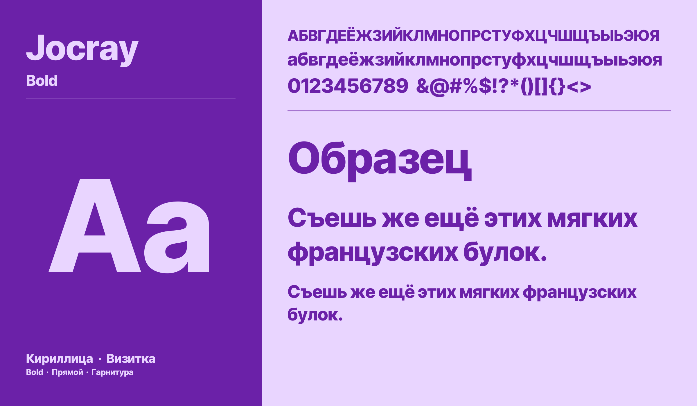
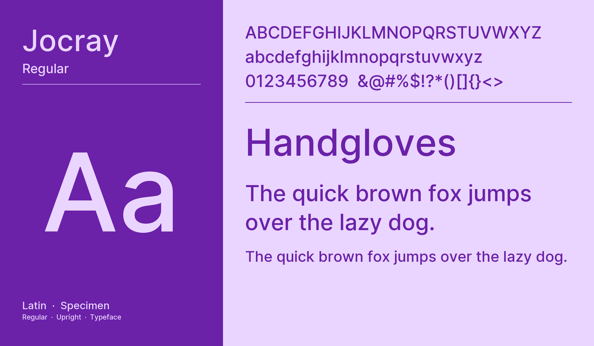

# JOCRAY Brand Typography

Typography plays a critical role in the JOCRAY visual identity. This directory contains our custom/signature typeface family used across all digital products, overlays, and marketing materials.

## Font Family: Jocray

We utilize two primary weights to maintain a clean yet impactful visual hierarchy:
- **Jocray Regular**: Optimized for readability in text blocks, descriptions, and user interfaces.
- **Jocray Bold**: Designed for headlines, tournament announcements, stream overlays, and high-impact messaging.

## Visual Showcases

| Font Weight / Style | English Version (EN) | Russian Version (RU) |
| :--- | :---: | :---: |
| **Jocray Bold** |  |  |
| **Jocray Regular** |  |  |

## Directory Contents

- `jocray_fonts/`: Contains the official `.ttf` (TrueType Font) files.
- `jocray_illustration/`: Includes visual previews and examples of the typography in action for both English (EN) and Russian (RU) locales.

## Licensing
Please refer to the [LICENSE](LICENSE) file in this directory for Open Font License (OFL) details before using these assets.
