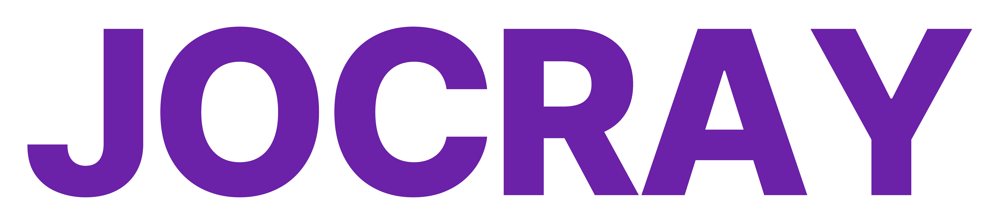
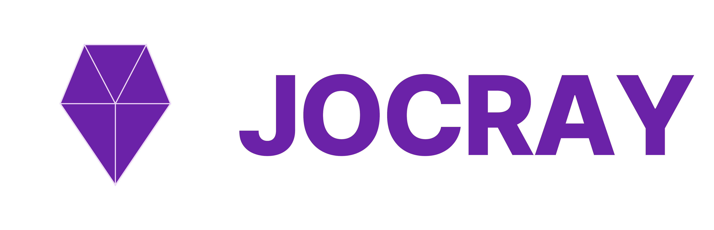

# JOCRAY Brand Logotypes

This folder contains the official logotypes and symbols for the JOCRAY media outlet. These assets represent our brand identity across live streams, tournaments, and social media platforms.

## Visual Showcase

| Standalone Symbol | Wordmark Text | Combined Logotype |
| :---: | :---: | :---: |
|  |  |  |

## Asset Varieties

- **Symbol (`jocray_symbol.png`)**: Our standalone brand icon, perfect for profile pictures, favicons, and compact spaces.
- **Text (`jocray_text.png`)**: The stylized "JOCRAY" wordmark used when the brand name needs to be clean and prominent.
- **Combined (`jocray_symbol_text.png`)**: The primary combination of our symbol and text, recommended for banners, official documents, and main stream overlays.

## Usage and Licensing
All logo assets in this folder are protected. Usage is strictly governed by the End-User License Agreement found in the [LICENSE](LICENSE) file.
