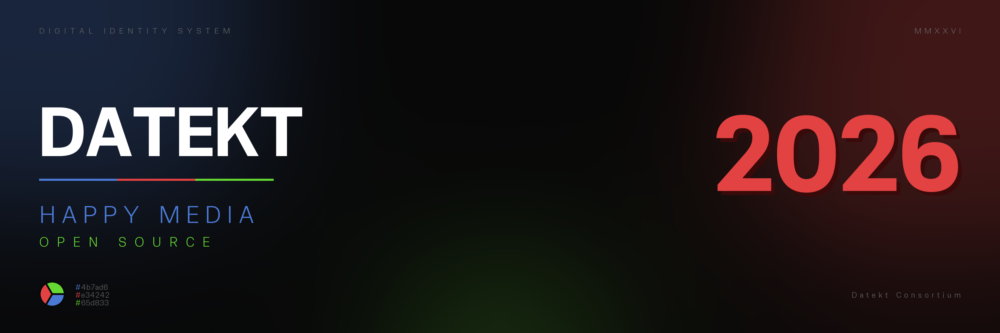

  

***

<h3 align="center">Happy Media :)</h3>

  

***

## 🌐 Datekt Consortium

Welcome to the official platform of the independent digital team **Datekt**. We create tools that bring joy—not just to us, but to content creators as well. Join our community, and together, let’s make content shine brighter.

---
*© 2026 Datekt Consortium. All rights reserved. Designed for people.*